# Coding Agent Usage Meter

**A small Windows widget that shows how much of your Claude Code and Codex limits you have used, and the local dev servers you have running.**

<p align="center">
  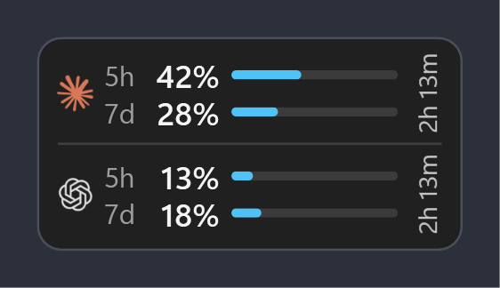
</p>

Claude Code and Codex both stop you when you hit a limit: one that resets every **5 hours** and one that resets every **7 days**. This widget sits on your desktop, above the clock, and shows both for each agent, so you always know how much you have left.

- **5h** and **7d** show how much of each limit is used. Blue is fine, **amber at 75%**, **red at 90%**.
- **2h 13m** is the time until the 5-hour limit resets.
- It updates by itself every few minutes. Click it to update now.
- If it can't update (offline, signed out), the numbers turn grey and it says why.
- It lists your **local dev servers** (`localhost:3000`, Docker containers in WSL and so on), so you can open or stop them in one click.

Codex shows up by itself if you have it installed. If not, you only see Claude.

> For **Windows 11** only. Not made by or connected to Anthropic or OpenAI.

## Contents

- [Install](#install)
- [Use it](#use-it)
- [Six looks](#six-looks)
- [What the colours and signs mean](#what-the-colours-and-signs-mean)
- [Settings](#settings)
- [Tray icon](#tray-icon)
- [Dev servers](#dev-servers)
- [Is it safe?](#is-it-safe)
- [For developers](#for-developers)

## Install

You need:

- **Windows 11**
- **Claude Code**, signed in with a Claude Pro or Max plan. Check by running `claude` in a terminal.
- **Codex** (optional), signed in with ChatGPT

### The quick way

Open **PowerShell** (Start → type `PowerShell`), paste this line and press Enter:

```powershell
irm https://raw.githubusercontent.com/photomohsen/Coding-Agent-Usage-Meter/main/install.ps1 | iex
```

It downloads the widget to `%LOCALAPPDATA%\Coding Agent Usage Meter`, installs .NET 10 if you don't have it, puts a **Coding Agent Usage Meter** shortcut on your desktop and starts the widget. Paste the same line again later to update it.

### Or download the ZIP

1. **Download it.** On this page click **Code → Download ZIP**, then unzip it to a folder you'll keep (for example `Documents\Coding Agent Usage Meter`). The widget runs from this folder, so don't delete it.
2. **Double-click `Install.cmd`.** It installs .NET 10 if you don't have it, builds the widget, puts a **Coding Agent Usage Meter** shortcut on your desktop and starts the widget.
   If Windows shows *"Windows protected your PC"*, click **More info → Run anyway**.
3. **That's it.** The widget appears above the clock. Drag it anywhere.

To update, unzip the new ZIP over the old folder and double-click `Install.cmd` again. Your settings are kept.

<details>
<summary>Install by hand instead</summary>

```bash
winget install Microsoft.DotNet.SDK.10
git clone https://github.com/photomohsen/Coding-Agent-Usage-Meter.git
cd Coding-Agent-Usage-Meter
dotnet build prototype/UsageWidget.Prototype
```

Then double-click `Start Widget.vbs` to start it.

</details>

### Starting it later

- Double-click **Coding Agent Usage Meter** on your desktop.
- Or let it start by itself: right-click the widget → **Settings** → turn on **Start with Windows**.

To quit, right-click the widget → **Quit**.

## Use it

| Do this | To |
|---|---|
| Click | Update now |
| Drag | Move it (it remembers where). Drop it near the clock and it snaps into place just above it |
| Hover an agent | See a card with both limits, their reset times, and why the numbers are old if they are |
| Right-click | Open the menu: update, pick a look, Compact, Settings, Help, Quit |
| Ctrl + mouse wheel | Make it bigger or smaller |
| ← / → | Switch look |

The widget also hides by itself while a full-screen app, game or presentation is open.

<p>
  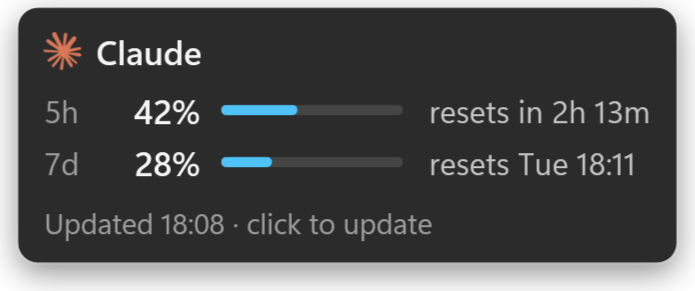
  &nbsp;
  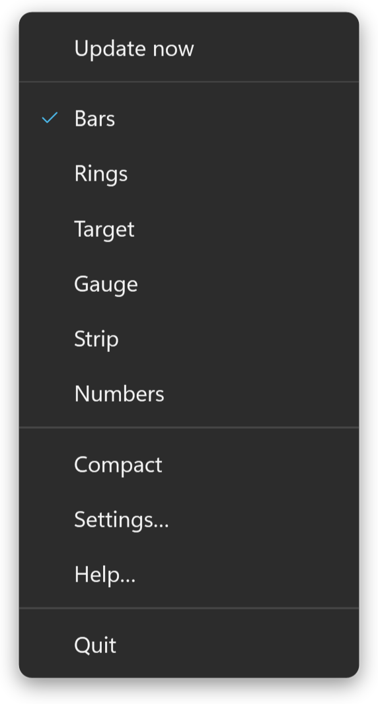
</p>

## Six looks

Pick one in **Settings → Look**, the right-click menu, or with ← / →. Each look has a **Full** set and a **Compact** set: Compact shows fewer parts (for example only the higher limit, no labels), so it takes less room.

| Look | Full | Compact |
|---|---|---|
| **Bars** (default) · a bar per limit |  | 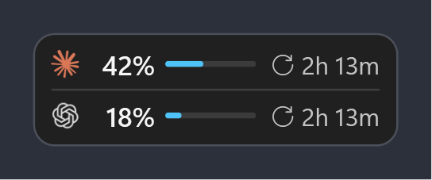 |
| **Rings** · a ring per limit around the logo | 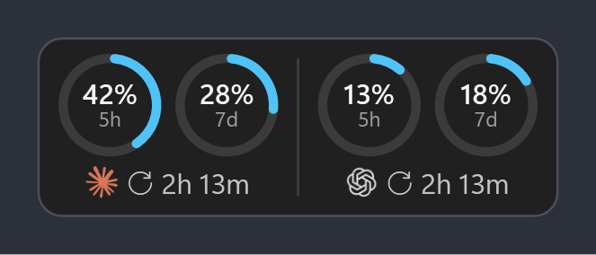 | 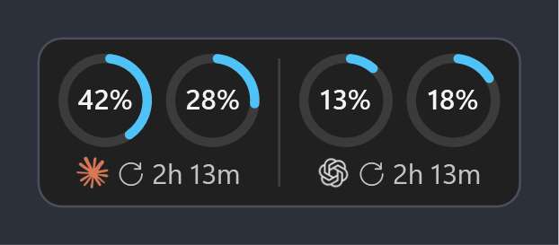 |
| **Target** · a double ring, like the tray icon | 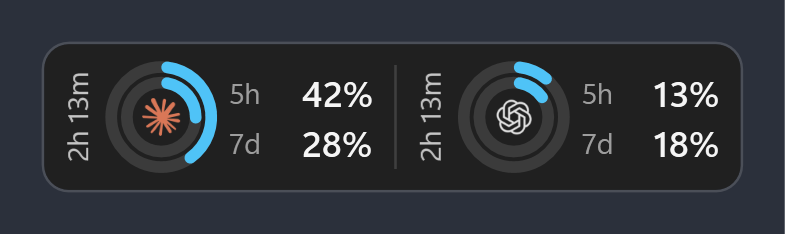 | 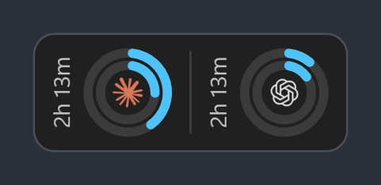 |
| **Gauge** · a half dial, 5h outside, 7d inside | 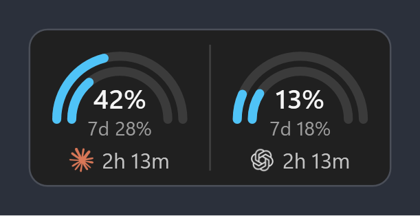 | 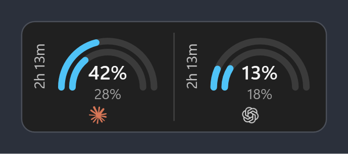 |
| **Strip** · one thin line per agent | 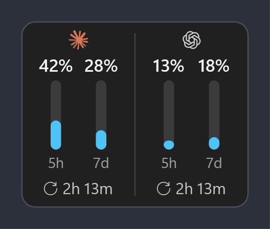 | 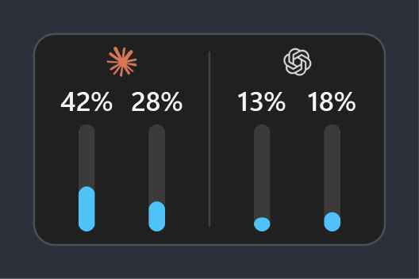 |
| **Numbers** · just the numbers, big | 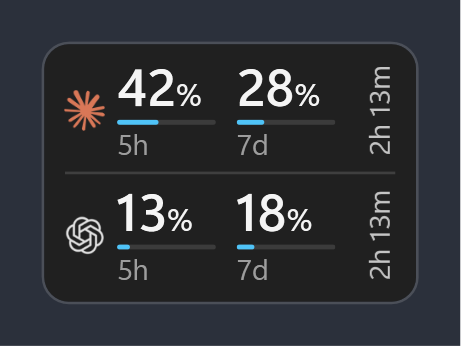 | 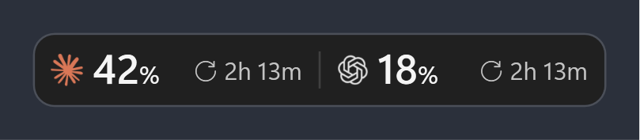 |

Every part of a look can be turned on or off in Settings. A few you might like:

| Pace tick and "fast" | Blocks instead of bars | Side by side | "Updated" time and clock time |
|---|---|---|---|
| 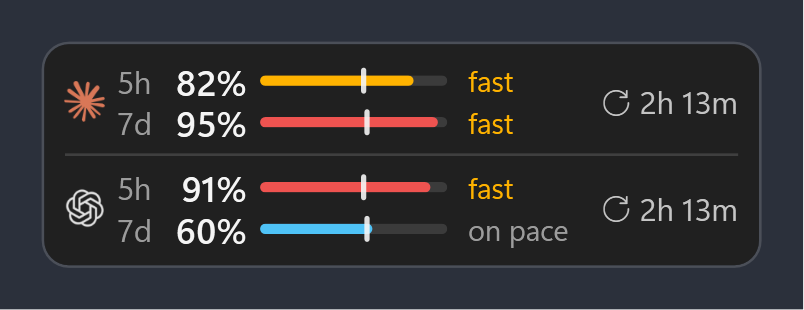 | 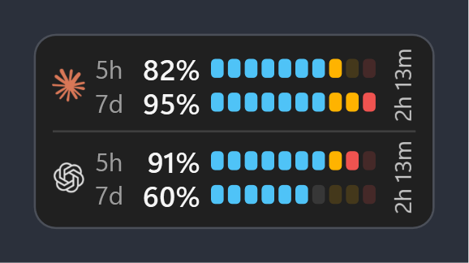 | 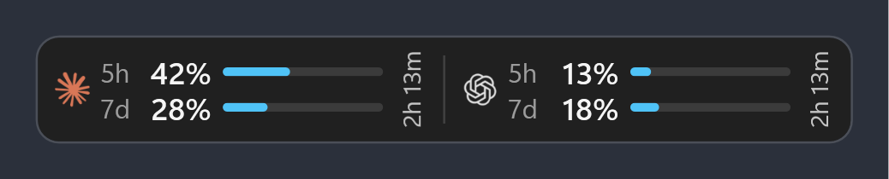 | 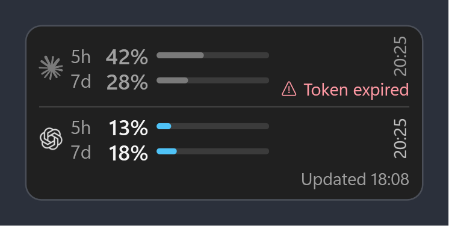 |

The **pace tick** marks where you'd be if you used the limit evenly until it resets. "fast" means you're ahead of it.

## What the colours and signs mean

| Normal | High | Old numbers | Not signed in |
|---|---|---|---|
| 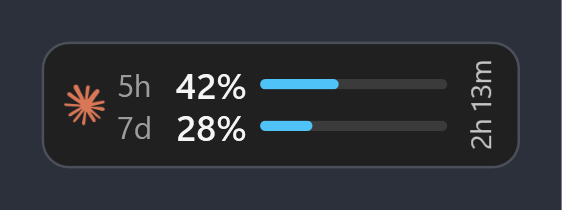 | 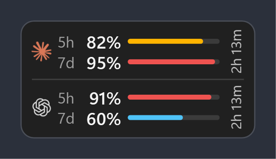 | 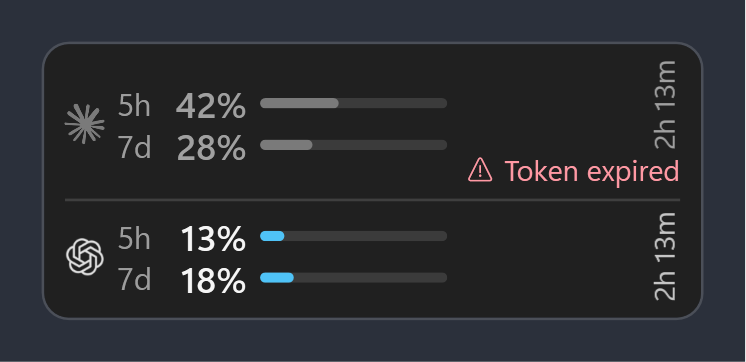 | 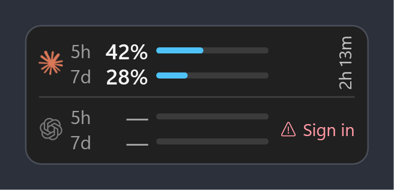 |
| Blue: under 75% | Amber at 75%, red at 90% | Grey, with **⚠** and the reason | **—** and what to do |

When the numbers are old, hover the agent to see why and since when:

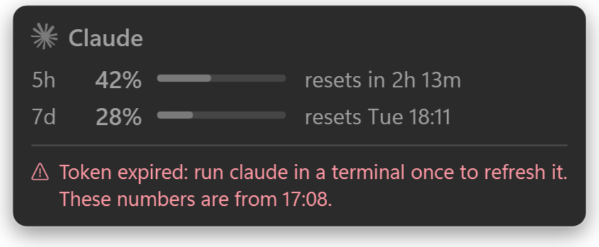

## Settings

Right-click the widget → **Settings**.


- **Look** and **Compact**, and under them every part of that look: which limits, the logo, the percent, labels, bar style and length, the pace tick, the reset time (time left or clock time), the "Updated" time, and how much to say when the numbers are old. **Back to suggested** undoes your changes to that look.
- **Tray icon**: bars or rings.
- **Size** and **Opacity when idle**.
- **Update every** 1 to 30 minutes.
- **Always on top**, **Show Codex**, **Start with Windows**.
- **Reset position**, if it's ever off screen.

Settings are saved in `%APPDATA%\ClaudeUsageWidget\settings.json`.

<br clear="right">

## Tray icon

Next to the clock there is a small icon with two bars: Claude on top, Codex below. Each bar fills with the usage and turns amber at 75% and red at 90%. It turns grey when the numbers are old.

In **Settings → Tray icon** you can pick **Rings** instead: Claude is the outer ring and Codex the inner one. Without Codex, the outer ring is the 5-hour use and the inner ring the 7-day use.

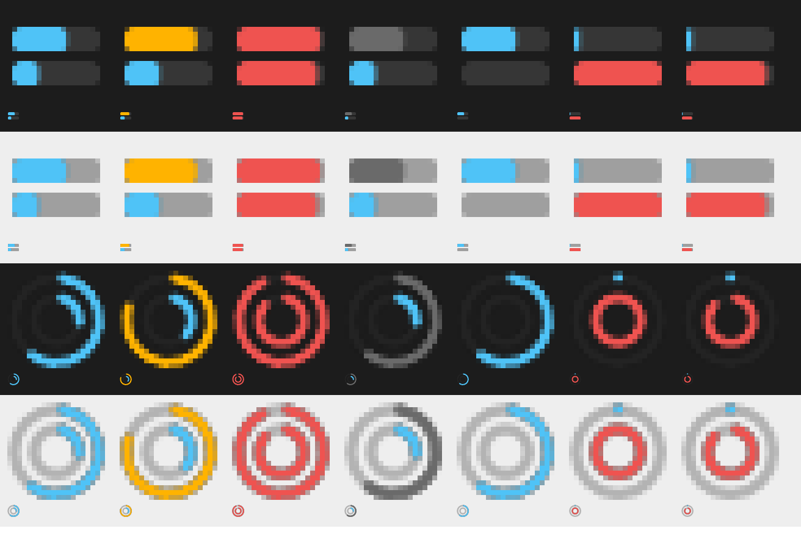

| Do this | To |
|---|---|
| Hover the icon | See the numbers |
| Click the icon | Hide or show the widget |
| Right-click the icon | Update now, Settings, Quit |

## Dev servers

Under the look, the widget lists the local dev servers you have running, with their project name.

<p>
  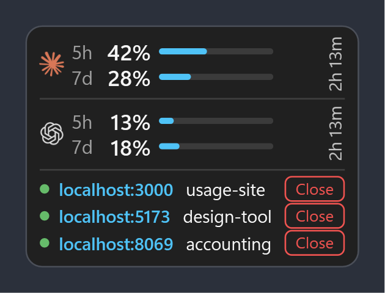
  &nbsp;
  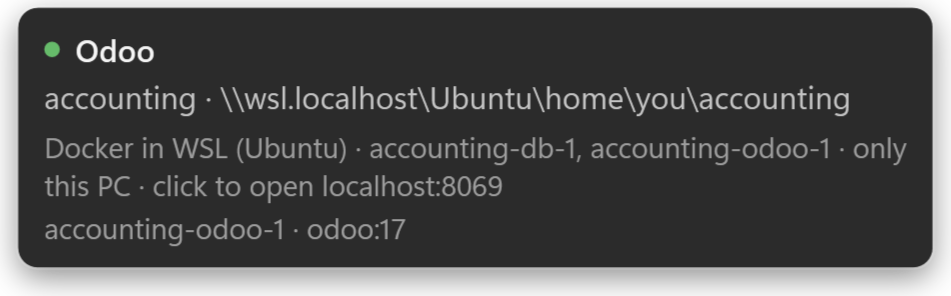
</p>

- **Click `localhost:3000`** to open it in your browser.
- **Hover a row** to see the project folder and what runs it.
- **Close** stops it. It always asks first.

It finds:

- **Programs on Windows**: node, deno, bun, python, dotnet, java, ruby, php, go, vite, hugo and a few more. The row is named after the git repo the server runs in, so a server started in `my-repo\app` shows as `my-repo`. A git worktree shows as its main repo. Without a repo, the name is the nearest folder with a `package.json`, `.csproj`, `pyproject.toml` and so on. Close stops the program and everything it started.
- **Docker containers in WSL**: shown under their Compose project (`accounting`, `erpnext`…), with the folder in WSL. Close runs `docker stop` on that project's containers. They keep their data and start again with `docker compose up`.
- **Programs running in WSL** (a node or python server started there), named after their git repo too. Close stops that program.

System services that also listen on a port never show, so you can't stop one by mistake.

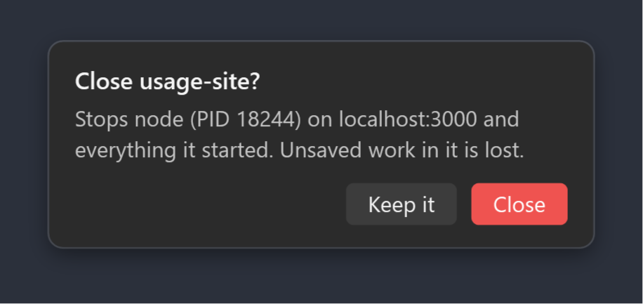

## Is it safe?

Yes. It only reads, on your own PC, the sign-in that Claude Code and Codex already saved, and asks Anthropic and OpenAI for your usage. Nothing is sent anywhere else, and it never changes your sign-in.

Each PC shows the usage of whoever is signed in on it.

| Agent | Reads | Asks |
|---|---|---|
| Claude Code | `~/.claude/.credentials.json` | `api.anthropic.com/api/oauth/usage` |
| Codex | `~/.codex/auth.json` | `chatgpt.com/backend-api/wham/usage` |

- The tokens are only read. When the Claude token has expired, the widget runs `claude auth status` in the background (at most every 10 minutes) so the Claude CLI refreshes it.
- When Codex can't be reached, it shows the last limits from Codex's own logs (`~/.codex/sessions`), in grey.
- These endpoints aren't documented, so a change on their side can break the widget.

## For developers

It's a WPF app on .NET 10, in [`prototype/UsageWidget.Prototype`](prototype/UsageWidget.Prototype).

```bash
dotnet build prototype/UsageWidget.Prototype
```

| File | What's in it |
|---|---|
| `PrototypeWindow.cs` | The widget window and the six looks |
| `Settings.cs`, `SettingsWindow.cs` | Saved settings and each look's options |
| `ClaudeUsageClient.cs`, `CodexUsageClient.cs` | Reading the usage |
| `DevServers.cs` | Finding and stopping dev servers, on Windows and in WSL |
| `TrayIcon.cs` | The tray icon |
| `Qa.cs`, `E2e.cs` | The screenshot check and the end-to-end test |

It runs through `dotnet.exe` instead of its own `.exe`, so it also works where unsigned programs are blocked.

### Checks

**Screenshots of every look and state**, with made-up numbers. The pictures in this README come from it:

```bash
dotnet prototype/UsageWidget.Prototype/bin/Debug/net10.0-windows/UsageWidget.Prototype.dll --qa qa
```

**End-to-end test of the dev servers.** It starts a real server in WSL, a real Docker container and a Windows python server. It checks the widget finds each one under the right project, stops each one through the widget's own Close, and checks it's gone and that WSL's other ports still work. Name servers you already run to check they're found too:

```bash
dotnet prototype/UsageWidget.Prototype/bin/Debug/net10.0-windows/UsageWidget.Prototype.dll --e2e 8069:accounting,8080:erpnext
```

It prints one PASS or FAIL line per check, ends with `E2E PASSED` or `E2E FAILED`, and saves the same lines to `e2e.log` next to the dll. It needs WSL with Docker and the `redis:6.2-alpine` image, and cleans up after itself.

Why it works this way: [docs/adr](docs/adr). Words used in the code: [GLOSSARY.md](GLOSSARY.md).

## License

[MIT](LICENSE)
