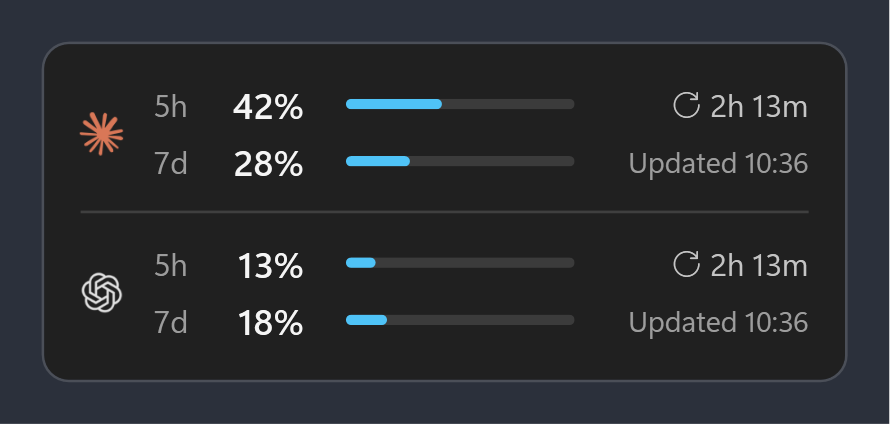
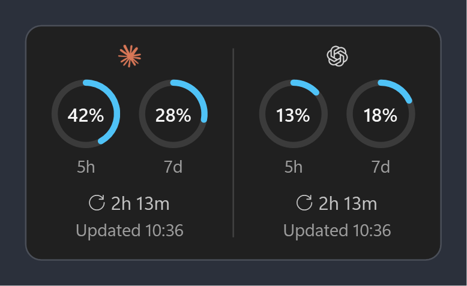
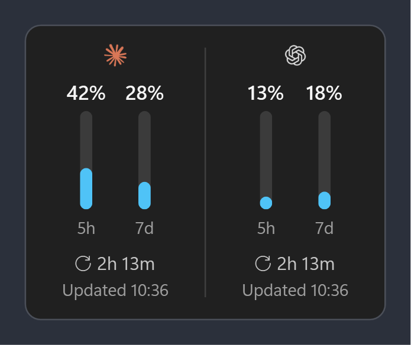
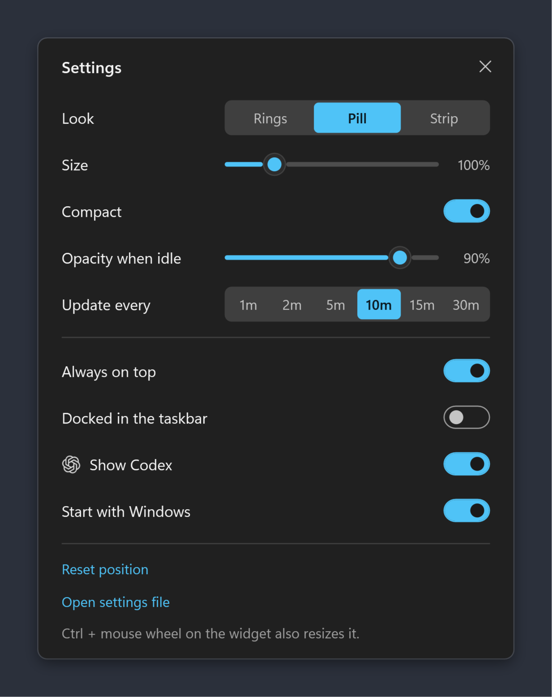

# Coding Agent Usage Meter

A small Windows desktop widget that shows how much of your coding agents' usage limits you have used: **Claude Code** and **Codex**, side by side, always in view.



Both tools have a **5-hour Session limit** and a **7-day Weekly limit**. Hitting one in the middle of a task is annoying, and checking means opening `/usage` or `/status` each time. This widget keeps the numbers on your desktop and updates them on its own.

> Not affiliated with Anthropic or OpenAI. It reads endpoints that are not documented, so an update on their side can break it.

## What it shows

For each agent:

- **5h** and **7d**: the percentage of your Session and Weekly limit used. The bar turns amber at 75% and red at 90%.
- **↻ 2h 13m**: time until the Session limit resets.
- **Updated 10:36**: when the numbers were last fetched. If an update fails, the numbers turn grey (Stale) and the line says why, for example *Offline* or *Token expired*. Hover the widget for the full details.

Codex appears automatically when it is installed (`~/.codex` exists). Without it, the widget shows Claude only. You can also hide Codex in Settings.

## Looks

Pick a look in Settings, or press **←** / **→** on the widget.

| Pill (default) | Rings | Strip |
|---|---|---|
|  |  |  |

- **Compact** shows the same parts with less space around them.
- **Size** scales the widget from 50% to 300% (or Ctrl + mouse wheel).
- **Docked in the taskbar** turns it into its own taskbar button. The label reads `70 28 · 17 7` (Weekly %, then Session %, Claude first), and the icon shows the time to the Session reset.

## Requirements

- Windows 11
- [.NET 10 SDK](https://dotnet.microsoft.com/download/dotnet/10.0)
- [Claude Code](https://docs.claude.com/en/docs/claude-code) (the `claude` command), signed in with a Claude Pro or Max plan
- Optional: [Codex](https://github.com/openai/codex), signed in with ChatGPT

## Install

```bash
git clone https://github.com/photomohsen/Coding-Agent-Usage-Meter.git
cd Coding-Agent-Usage-Meter
dotnet build prototype/UsageWidget.Prototype
```

Then double-click **`Start Widget.vbs`**. It starts the widget without a console window. It appears above the clock. Drag it wherever you like and it remembers the spot.

To start it with Windows, turn on **Start with Windows** in Settings.

## Using it

| Do this | To |
|---|---|
| Click | Update now |
| Drag | Move it |
| Ctrl + mouse wheel | Resize |
| ← / → | Switch look |
| Hover | See full numbers, reset times and any error |
| Right-click | Menu: Update now, Compact, Dock to taskbar, Settings, Help, Quit |



Settings apply at once and are saved to `%APPDATA%\ClaudeUsageWidget\settings.json`.

## How it works

Everything stays on your PC. The widget only reads the sign-in files the agents already keep, and it only talks to the services those agents already use.

| Agent | Reads | Asks |
|---|---|---|
| Claude Code | `~/.claude/.credentials.json` | `api.anthropic.com/api/oauth/usage` |
| Codex | `~/.codex/auth.json` | `chatgpt.com/backend-api/wham/usage` |

- **The tokens are read-only.** The widget never refreshes or writes them, because refreshing rotates the sign-in and could sign you out of the agent. When the Claude token has expired, it runs `claude auth status` in the background (at most every 10 minutes), so the Claude CLI refreshes it the normal way. The Claude desktop app keeps its own sign-in, which is why this file can go out of date while you work in the app.
- **When Codex can't be reached**, the widget shows the last limits Codex wrote to its own session logs (`~/.codex/sessions`), marked Stale with their time.
- Nothing is sent anywhere else, and no account is involved: each PC shows the usage of whoever is signed in on it.

The reasons behind these choices are in [docs/adr](docs/adr).

## Also in the widget: dev servers

Below the usage, the widget lists local dev servers that are running (node, python, dotnet, vite and similar) with their `localhost` port. Click one to open it in the browser, or **Close** to stop it. The list is hidden when nothing is running.

## Status

This is a working prototype (`prototype/UsageWidget.Prototype`). The plan for the full version is in [.scratch/usage-widget](.scratch/usage-widget). It runs through `dotnet.exe` instead of its own `.exe`, so it also works on PCs whose app control blocks unsigned programs.

To check a change without waiting for real errors or high usage, render every look and state to PNG files with made-up numbers:

```bash
dotnet prototype/UsageWidget.Prototype/bin/Debug/net10.0-windows/UsageWidget.Prototype.dll --qa qa-out
```

## License

[MIT](LICENSE)
